```mermaid
---
config:
  themeVariables:
    fontFamily: "iosevka"
---
flowchart TD


Shopping 
style Phone stroke-width:4px,fill:#333,stroke:#42affa
Fax 
Errands 
Work
Home
```

---
{"dg-publish":true,"permalink":"/obsidian-for-learning-part-iii-projects/","tags":["project/nb"],"noteIcon":"","updated":"2026-10-17T18:04:33.969+01:00","dg-note-properties":{"start":"2026-08-07","due":"2026-09-30","up":["[[Projects/No Boilerplate Index]]"],"tags":["project/nb"],"state":"done"}}
---


<!-- skip_slide -->
<!-- end_slide -->



```mermaid
---
config:
  themeVariables:
    fontFamily: "iosevka"
---

flowchart TD

    A@{ shape: database, label: "Atomic Notes" }
    P@{ shape: processes, label: "Projects" }
    
    style N stroke-width:4px,fill:#333,stroke:#42affa
    
    style P stroke-width:4px,fill:#333,stroke:#42affa
    style X stroke-width:4px,fill:#333,stroke:#42affa
    style Y stroke-width:4px,fill:#333,stroke:#42affa
    style Z stroke-width:4px,fill:#333,stroke:#42affa
    style ZZ stroke-width:4px,fill:#333,stroke:#42affa
    
    F@{ shape: card, label: "Fleeting Notes" }
    L@{ shape: card, label: "Literature Notes" }
    L -->|Reference from| A
    F -->|Process Into| A
    A -->|Compose Into| P
    
    subgraph N["."]
        P -->|Write| X@{ shape: documents, label: "Essays" }
        P -->|Write| Y@{ shape: documents, label: "Dissertations" }
        P -->|Write| Z@{ shape: documents, label: "Exam Revision" }
        P -->|Think| ZZ@{ shape: documents, label: "Ideas" }
    end
```

We've finally arrived in the final part of the FLAP system.

---

## THE TEMPORAL CONTRACT

```mermaid
---
config:
  themeVariables:
    fontFamily: "iosevka"
---
flowchart LR
    style B stroke-width:4px,fill:#333,stroke:#42affa
    A[PAST SELF] -->|Write Notes| B
    B[PRESENT SELF] -->|Write Notes| C[FUTURE SELF]
```

<!-- font_size: 1 -->
<!-- new_lines: 2 -->


<!-- new_lines: 2 -->

the unfortunately great ritual:
1. Write notes to yourself
2. Process them daily

In part 1, I told you how to build the habit of daily processing, the temporal contract recruiting help from the you of yesterday and the you of tomorrow, to help solve today's problems.

---


<!-- column: 1 -->
<!-- alignment: left -->
<!-- new_lines: 14 -->

🟡 fleeting 🔴 literature  🔵 atomic

Then in part 2, how to build loosely coupled but highly cohesive atomic notes out of your fleeting thoughts and other people's highlights.

You now have everything you need to build novel work of your own.

---



 
```mermaid
---
config:
  themeVariables:
    fontFamily: "iosevka"
---
flowchart TD 
    subgraph SYSTEM INPUTS
        Fleeting@{ shape: docs, label: "#Fleeting" }
        Literature@{ shape: docs, label: "#Literature" }
    end
    
    style DDDD stroke-width:4px,fill:#333,stroke:#42affa
    Atomic@{ shape: database, label: "#Atomic Notes" }
    IsAtomic@{ shape: braces, label: "Teachable?" }
    DDDD@{ shape: processes, label: "DEFER" }
    
    Fleeting ==> IsAtomic 
    IsAtomic ==>|yes: process into| Atomic
    IsAtomic -->|no: do it| DDDD
    Literature ==>|reference from| Atomic
```

Some of our fleeting thoughts will require action,
and some networks of linked atomic thoughts will become SO compelling that they will require action, too.

But to do so, you will need a SYSTEM:

---

<!-- slide bg="https://static1.colliderimages.com/wordpress/wp-content/uploads/2022/06/everything-everywhere-all-at-once.jpg" data-background-opacity="0.2" -->

<!-- new_lines: 1 -->

# PART 0: What should I be doing RIGHT NOW?

<!-- new_lines: 1 -->
<!-- font_size: 2 -->

<!-- end_slide -->
<!-- skip_slide -->

The single thing I need my task systems to do, from a simple shopping list to complex project management software, is to answer the question "What should I be doing RIGHT NOW?"

In this video I'll evolve 10 years of optimisation in 10 minutes, going from simple to complex, allowing you to drop off when you think the complexity is right for you, which could be right now, with no system, before I've told you anything!

If so: Good for you, get back to it, please tell me how you do it in the comments!

Let's start simple:

---

<!-- slide bg="[Resources/Meta/attachments/twin-peaks-red-room.jpg](/img/user/Resources/Meta/attachments/twin-peaks-red-room.jpg)" data-background-opacity="0.2" -->

> Diane, 11:30 a.m., February 24th. Entering the town of Twin Peaks, five miles south of the Canadian border, twelve miles west of the state line. Never seen so many trees in my life.

> _"Diane, today I've got to write 400 words on the paper, go to the gym, and get food for dinner tonight."_

The habit of thinking about what you need to do today and writing it down before you start your day is honestly 90% of productivity.
Our brain already KINDOF knows what it should be doing, if only we would shut up for a moment and listen.

You can do this on paper, on a tablet sketched in digital ink, typed in a note file, even spoken into a tape recorder as you drive to a mysterious town...

But if you use my favourite tool, Obsidian, you'll use daily notes.

---

<!-- slide bg="[Resources/Meta/attachments/album-every-day-is-exactly-the-same.png](/img/user/Resources/Meta/attachments/album-every-day-is-exactly-the-same.png)" data-background-opacity="0.1" -->

# PART 1: DAILY NOTES

- ~~TO DO LISTS~~
- ~~TASK LISTS~~
- ~~MORNING PAGES~~
- ~~BULLET JOURNALLING~~
- ~~INTERSTITIAL JOURNALLING~~
- _**DAILY NOTES**_

Here, after you have processed your fleeting notes in the morning, add in the checklists for what you want to do today, just dump your brain out into the note
- Maybe you've got to go shopping.
- Maybe you need to buy something.
- Maybe you need to finish that project.
- Maybe you need to write that report.
- Maybe you need to call your mum.

---

> Daily  

```md
# Daily Note
 
 
 
 
 
 
 
 
 
```

In obsidian, you run the "open daily note" command and you get a fresh note with an optional template added.

Dump all your tasks in, and then prioritize them.
This is key.
Work out what the most important thing to do is.
What **single** task would be the thing that if you finished, would kind of win the day.
(for me, right now, it'd be finishing this damn video script...)
If you're writing a book, you better write a few pages today and that would kind of win the day, too.

---

My template:

```md
## Daily Note
 
 
 
 
 
```

For tasks you do every day, a tip is to add them to your daily note template.

This might be all you need to get going.
Maybe you can store most of your life in your head.
If you can, that's wonderful. I'm very jealous. But this might not be enough.
It's not enough for me. How do you come up with these daily tasks, you just think about it?
Sounds fake.
And so we will go to the next level of complexity, which is to build long-running projects.

---

<!-- slide bg="[Resources/Meta/attachments/namtao-logo-1000.png](/img/user/Resources/Meta/attachments/namtao-logo-1000.png)" data-background-opacity="0.1" -->

<!-- new_lines: 2 -->


<!-- new_lines: 3 -->
## PUBLIC DOMAIN VIDEOS

<!-- new_lines: 1 -->

For all [links](), read my scripts at www.namtao.com

<!-- column_layout: [5,1] -->
<!-- column: 0 -->
<!-- column: 1 -->

<!-- new_lines: 0 -->


NO AI USED

<!-- reset_layout -->

<!-- end_slide -->
<!-- skip_slide -->

I dedicate my video scripts to the public domain.

Everything you see here: script, links, and images are part of a Markdown document available freely on my website, namtao.com, and at github.

---

<!-- slide bg="https://connortumbleson.com/content/images/2018/01/matrix_2_zion.JPG" data-background-opacity="0.08" -->

# PART 2: PROJECT FILES

## MODELLING CONCURRENCY

<!-- end_slide -->
<!-- skip_slide -->

The next logical step, instead of grouping things into tasks that need to happen today, is to have long-running projects:
- that birthday party that you're organizing.
- the big project at work.
- That book you're writing.
- Learning to play the guitar.
- Or coding the next Stardew Valley.

These things will take a little planning and projects never happen alone, we always have lots of projects on the go, but we are only one person.
So you create multiple lists per project.

And here is the important thing:
Within the project, the list is no longer ordered by importance. The list is by time, sequentially.
What do you have to do first?

Projects are not like days, where you've got energy that drain throughout the day, and you've got to get the important stuff done first.
A project is not a sprint.
A project is a marathon with checkpoints, with stages, with refilling stations, and you need to train for them.

---

```yaml
----
due: 2026-03-01
tags:
  - project
----
# Project Icarus

 
 
 
Who does the sun think it is? I'm not scared, in this essay I will

 
```

So keeping with obsidian, my favourite tool for all things plain text.

We'll make a project note, tagged `project`, and give it a due date.
The difference between a project list and a shopping list, is a project list has a due date.
Now write the tasks you need to do in order. Preparatory items at the start, finalizing items at the end. Maybe the first checklist item is to figure these out. Be a good thing to put in a template, wouldn't it?

You now have multiple projects on the go.
They're captured. You know which one should be done first. But that doesn't help you day to day.
Let's zoom back into the day. It's the morning. What do you do if you have LOADS of projects on the go? You don't look through all of these project notes and start worrying.

You use the next actions system.

---

<!-- slide bg="[Resources/Meta/attachments/stars.jpg](/img/user/Resources/Meta/attachments/stars.jpg)" data-background-opacity="0.1" -->

# PART 3: NEXT ACTIONS

## \*ACTIONS\*, NOT PROJECTS

<!-- end_slide -->
<!-- skip_slide -->

The next action system is one of the two standout features of GTD that I ADORE. (That's the book "Getting Things Done" by David Allen.) The second is Contexts, that we'll get to in a moment.
The next actions list solves the scaling issue that storing all of your projects as separate lists causes:
It's very reasonable for someone to have dozens of projects on the go at once.
Our lives are very complicated and if you're modelling every little bit of it in your system, as you should be able to, things can get rapidly out of hand.

---


_A selection of my active projects in an Obsidian Base_

You could put all your projects in an obsidian base, a table, maybe ordered by due date, that would be good, and I recommend you at least look at this once a week, for planning.
But that doesn't help you get stuff done, it just lets you see what large projects you have to do, and maybe panic about the deadlines a bit.
It doesn't tell you what you're doing today.
Remember, the system in a perfect world tells us what we are supposed to be doing right now: Each layer that we are adding gets us closer and closer to this unobtainable goal. So stick with it!
The next actions system is simple:

---


dataview code:

```js
filter(file.tasks, (t) => !t.completed)[0].text as "Next Action"
```

Instead of a table of projects arranged by due date you have a table of those projects' "next action" arranged by due dates.
A project's Next Action is the first unchecked checkbox in the file, the first todo, the first thing that is not yet done; the thing you've got to do NEXT.
Remember we didn't order the checkboxes in the project files by importance, we ordered them by which needs to be done **first**.

So what we have here is a list of all the projects that are ongoing and the very next thing we need to do for each of them.
And the first thing in the table is the most urgent of those projects with its next action.

This is really good, but we can do even better.

---


## [Support me on Patreon](http://www.patreon.com/noboilerplate)

- 📁 Obsidian Vault zip download
- 📼 Early, longer, and more detailed videos
- 👨‍🏫 1:1 Mentoring over video chat.
- ❤️ My infinite gratitude for allowing me to continue making these videos

<!-- end_slide -->
<!-- skip_slide -->

If a picture is worth a thousand words, a downloadable Obsidian vault is worth a million.
Everything I have talked about today is available for anyone who supports me on my Patreon, in addition to the previous two parts, Capture and Process.

If you'd like to see and give feedback on my videos up to a week early, as well as get private discord access, and even your name in the credits, it would be very kind of you to check my Patreon.

I also offer regular mentoring. If you'd like 1:1 tuition on Obsidian, personal organisation, programming, creative production, or anything that I talk about in my videos, do sign up and let's chat!

---

<!-- slide bg="[Resources/Meta/attachments/primer-spiral-brown.png](/img/user/Resources/Meta/attachments/primer-spiral-brown.png)" data-background-opacity="0.3" -->

# Part 4: Start Date

Recall that projects are notes tagged `project` that have a due date.
Let's add one more property to that, which is a start date.
This is something that I feel is missed, in a lot of project management and task management systems.

If I am seeing something that I can't yet start, perhaps:
- the next action of the "Sell Car" project, before you have done the research into which car you're going to get next.
- starting chapter two before finishing writing chapter one
- Or perhaps you just don't want to start the thing yet, you want a few more days of breathing room. That's totally valid.

---

```yaml[2]
----
start: 2026-01-01
due: 2026-03-01
tags:
  - project
----
# Project Icarus

 
 
 
Who does the sun think it is? I'm not scared, in this essay I will
```

This is what the start date field represents. It informs our next actions table.
Only projects that are started, that is, those after their start date, appear in next actions table.

---

# MAP

## THEN REDUCE

Let me be very clear:
It's vital to not just capture and plan exhaustively, as we have done in the first part of this video.
But then to cut down and tightly scope the day's tasks to only the things we really care about, only things that can be started, only the things that are important, only the things that **should** be started.
A start date goes a very long way to achieving that.

---

<!-- slide bg="[Resources/Meta/attachments/mermaid-gantt-example.png](/img/user/Resources/Meta/attachments/mermaid-gantt-example.png)" data-background-opacity="0.3" -->

# GANTTASTIC

Keen-eyed among you may have noticed that this is starting to look like a Project management Gantt chart with projects that start and finish at certain times.

That's by design.
But we can do EVEN BETTER:

---

<!-- slide bg="[Resources/Meta/attachments/garden-state-pattern.png](/img/user/Resources/Meta/attachments/garden-state-pattern.png)" data-background-opacity="0.1" -->

# PART 5: STATE

 ---

<!-- end_slide -->
<!-- skip_slide -->

Another excellent tool from the project management world that we can steal is a board with tasks moving between states, which is called a Kanban board.

In obsidian that's easy to do with the built-in bases feature, which the obsidian team recently added a Kanban view to:

---


_(more like **cantban** looking at all those overdue tasks...)_

Here's part of my actual obsidian kanban, where we can see that I'm:
- writing two episodes of The Phosphene Catalogue (one of which is overdue, woops!)
- Editing the video you are watching right now (how meta), and
- Producing episodes of Modem Prometheus and Decapsulate.

This is modelled simply in markdown with a state property, the last piece of metadata that I run my systems on:

---


Here we have the start and due dates in the project's Properties, as well as the new 'state' property

---

```yaml[6]
----
start: 2026-01-01
due: 2026-03-01
tags:
  - project
state: planning
----
# Project Icarus

 
 
 
Who does the sun think it is? I'm not scared, in this essay I
```

And here, is the final markdown template I use in all of my projects.

---

```yaml
----
start: 2026-01-01
due: 2026-03-01
tags:
  - project
state: planning
----
# Project Icarus

 
 
 
Who does the sun think it is? I'm not scared, in this essay I
```

This almost certainly will be enough for most people.
But there is one more feature from GTD that I said I would get back to: Contexts.

---

<!-- slide bg="[Resources/Meta/attachments/office-space-cubicle-tetris.png](/img/user/Resources/Meta/attachments/office-space-cubicle-tetris.png)" data-background-opacity="0.1" -->

#  PART 6: CONTEXT

 ---

<!-- end_slide -->
<!-- skip_slide -->

Some work can only be done in certain contexts, and to reduce distractions further, we can tag some tasks with them.

What are these contexts?

Well, here David Allen's GTD book is less useful: It was written in the late 90s, and is hilarious if read today.
His 90s contexts include:

---

 ---


<br/>
 ---


- Shopping
- Telephone
- Fax
- Errands
- Work
- Home

You may have noticed, all these are now on one single device, in one single room!

One computer or tablet or phone, or at the very least one room we do everything in.

---


"Spaceship You" CGP Grey


This is like the single module of CGP Grey's "Spaceship You", something he used as a metaphor for being trapped inside during the covid lockdowns.

But just like in Grey's video, the solution to the Context problem is to make the delination mental, not physical.

---


"Spaceship You" CGP Grey


Yes we may use the same device for work, gaming, reading, and communication, but these are very different MENTAL contexts, and we should identify the repeated contexts we slip into during the day and strengthen them.

For example, when sitting at your desk working from home at your 9-5, one shouldn't see tasks that you CAN'T do at this time, or they would be, by definition, a distraction.
And the reverse is true - work tasks should not show up and clutter your system during the evenings and weekends.

You will have many more contexts than work and home, but you will have to think about what they are for yourself.
Grouping tasks that can all be done in the same context together lets you reduce the switching cost, these mental overheads everyone warns you about.

To get you started (and for fun!), let me show you you what inspired my own weird contexts:

---

## Eudaimonia Machine


(From "Deep Work", Cal Newport)


When I read Deep Work by Cal Newport, a book I highly recommend, I was struck by his description of this cool piece of theoretical architecture.
The "Eudaimonia Machine" was a building where office workers could travel through different work contexts, and were not allowed to bypass rooms.
The whole thing was linear.

> (BTW: In philosophy "Eudaimonia" refers to a state of contented, virtuous, happiness - the first thing all of us think of when working in an office...)

As someone who works from home and can control their own schedule, I have discovered through a few years of self-reflection and testing that these 5 states map on to my own life contexts with very few changes, here are mine:

---

| TIME  | CONTEXT | ACTIVITIES    |
| ----- | ------- | ------------- |
| 06:00 | Chamber | Writing       |
| 11:00 | Library | Editing       |
| 14:00 | Office  | Production    |
| 16:00 | Salon   | Promotion     |
| 18:00 | Theatre | Entertainment |

_(they are ~~autisticly~~ conveniently in alphabetical order)_


- I start my day in the Chamber, where deep work happens. No web access, no distractions. I leave my phone in the other room! I find that my mornings are when my best creative writing happens, perhaps, as some have ventured, in the mornings we still remember our dreams. On a more practical note, I have not yet, at this time, read Hacker News.
- I then move to the Library, where lighter writing happens. I allow myself a web browser at this stage, letting me look up facts and figures:
    - WAS big ben still being repaired in 1976?
    - When was Ada Lovelace born?
    - How many litres of fresh water does a data centre use per day? (That sort of thing.)
- The Office is the mode I used to spend most of my days in: bouncing around between tasks, email, writing, anything that seemed urgent. It's still a useful "open" work mode for me, but I allow myself into it only after the focussed morning hours have passed me by.
- Finally, in the late afternoon, I drop into the Salon. This is where conversation happens. For me that's replying to messages and emails that were low-priority and so I snoozed them to this time. It's also when you'll likely find me hanging out on my discord server (link at noboilerplate.org).
- The "Theatre" is an odd one out, here, and I'm not quite sure if the name is right. I don't tag tasks with it, this is a time when I *DON'T* do any tasks. I try to spend my evenings enjoying high-quality leisure like movies, socialising with my friends, perhaps playing D&D or video games. I got into the habit of stepping away from my keyboard at the end of the day before I had cured my RSI with powerlifting, but it's a good habit for my mind, as well as my body, so I've kept it.

---

<split left="1" right="" wrap="2">

TAG A TASK:

```md
 
```

QUERY:

````md
```tasks

not done
tags include salon

```
````

LOOKS LIKE:

</split>


Your contexts will be very different from mine, especially as you'll likely have a more rigid work or family life structure, but perhaps your weekends or evenings might take some inspiration from this.
My life did not look like this when I was a senior software engineer working a 9-5, yours won't either, but if you need to, finding your own contexts is a very worthwhile exercise.

---

<!-- slide bg="[Resources/Meta/attachments/tpc3.2-logo.png](/img/user/Resources/Meta/attachments/tpc3.2-logo.png)" data-background-opacity="0.2" -->

# SANITY CHECK:

## _"why are we doing all this?"_

(honestly, fair)

<!-- end_slide -->
<!-- skip_slide -->
My friend Milo recently asked me this question when I told them about my complex obsidian systems.

And it's a fair question!

you probably don't need everything I've talked about today, you could perhaps:
- start with just daily notes
- then add projects with state
- next actions
- then, if you need it, tag tasks with their contexts

If you are happy with your productivity, I envy you, and please tell me how you achieved this nirvana.
But at some point you may yet find yourself in the position where your old habits and systems need to improve to fulfil new needs of college, work, or your expanding ambitions and abilities.

---

## THE SYSTEM
## OF LAST RESORT

```mermaid
---
config:
  themeVariables:
    fontFamily: "iosevka"
---
flowchart LR


style WORK stroke-width:4px,fill:#333,stroke:#42affa
style TASKS stroke-width:4px,fill:#333,stroke:#42affa
style PROJECTS stroke-width:4px,fill:#333,stroke:#42affa
style CONTEXT stroke-width:4px,fill:#333,stroke:#42affa
style NA stroke-width:4px,fill:#333,stroke:#42affa
style STATE stroke-width:4px,fill:#333,stroke:#42affa

NA[NEXT ACTION]
TASKS -->|belong to| PROJECTS
TASKS -->|can be done in a| CONTEXT
PROJECTS -->|exist in a| STATE
PROJECTS -->|have exactly one| NA

CONTEXT --> WORK
NA --> WORK
STATE --> WORK[NOW GET TO WORK]
```



<!-- end_slide -->
<!-- skip_slide -->

Remember what we are building here:
A system of last resort, the process that when deadlines loom and stress is high, you can rely upon to get you through without forgetting anything.

You're building this system to actually get work done, NOT to organise yourself endlessly: Be aware of the seductive optimisations of toxic productivity.

---

<!-- slide bg="[Resources/Meta/attachments/station6-preview-blueprint.png](/img/user/Resources/Meta/attachments/station6-preview-blueprint.png)" data-background-opacity="0.2" -->

 ---

## BUT NO SIMPLER

In short: Make your task management system as simple as possible, but no simpler.
Good luck!

---


https://patreon.com/noboilerplate

Thanks for listening to the end, folks. If you're still here, you might be interested in the recordings of an autistic deep-dive livestream in 5 parts I did on all my Obsidian plugins, I have more than 100, over on my patreon at patreon.com/noboilerplate.

---

# Thank You

<!-- end_slide -->

To all my patrons, you make this possible!

```rust
let sponsors = [
 "Jaycee"
];
let patrons: [&str; 982];
```

I'd be very grateful for your support at [patreon.com/noboilerplate]() 💝

<!-- skip_slide -->

If you would like to support my channel, get early ad-free and tracking-free videos, your name in the credits or 1:1 mentoring, head to my patreon or ko-fi.

If you're interested in transhumanism and hopepunk, please check out my weekly sci-fi audiofiction podcast, Lost Terminal.

If you like urban fantasy, I produce a wonderful podcast called Modem Prometheus.
I just finished Season 3 of The Phosphene Catalogue, if you like mysteries and art, check it out!

Transcripts and compile-checked markdown sourcecode are available on namtao.com and github, links in the description, and corrections are in the pinned ERRATA comment.

Thank you so much for watching, talk to you on Discord.
